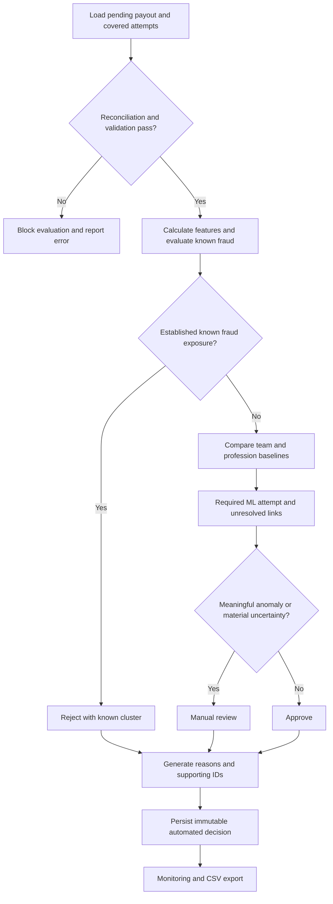

# Business rules

Status: initial policy. Rules labelled **proposed** specify implementation choices that require verification or clarification.

## 1. Settlement and reconciliation

All times and collection dates are IST. The scenario clock is 13 November 2026, 10:00 IST. Payouts are created at 17:30 IST on weekdays. Settlement follows the brief's T+2 schedule:

| Collection day | Payout day |
| --- | --- |
| Monday | Wednesday |
| Tuesday | Thursday |
| Wednesday | Friday |
| Thursday | Following Monday |
| Friday | Following Tuesday |
| Saturday and Sunday | Following Wednesday (combined with Monday) |

Use `team_id` and inclusive `covers_from`/`covers_to` to identify all covered attempts. A payout is the sum of `amount_usd + tip_usd` for captured payments only; its `txn_count` counts captured payments only. Declined and refunded attempts contribute zero to payout value but remain available for risk analysis. Use integer cents internally. The application evaluates supplied payouts; it does not create settlement schedules or transfer funds.

## 2. Decision policy

| ID | Rule |
| --- | --- |
| BR-01 | Each pending payout receives exactly one effective decision. |
| BR-02 | Reject only for established exposure to a known fraud case; attach the fraud cluster and evidence. |
| BR-03 | Unusual behaviour without established exposure goes to Manual review. |
| BR-04 | Approve when no meaningful anomaly or unresolved risk is found and available evidence supports normal behaviour. |
| BR-05 | Every Manual review and Reject must include an actionable reason and supporting record IDs. |
| BR-06 | Risk operations can override any original decision with a reason; all overrides are recorded. |
| BR-07 | **Proposed:** invalid batches are not evaluated; invalid data never silently approves. If unresolved risk remains on an otherwise valid payout, route to review. |
| BR-08 | **Proposed:** known fraud exposure takes precedence over statistical/ML findings. ML scores cannot independently reject. |

## 3. Historical context

Historical labels are `AUTO_APPROVED`, `MANUAL_APPROVED`, and `REJECTED`. Historical manual approvals are resolved reviews, not currently held money. Reason codes supplied in the brief:

- `OUTLIER_VERIFIED`, `VOLUME_SPIKE_VERIFIED`, `CARD_TESTING_VICTIM`
- `FRAUD_CARD_RING`, `FRAUD_CARD_TESTING`, `FRAUD_ACCOUNT_TAKEOVER`

Use rejected payouts with supported fraud reasons as case seeds. A victim, verified outlier, shared bank routing number, common address or a missing identifier does not by itself establish fraud. Review the historical explanation locally to distinguish implicated records from incidental associations. Avoid using future or current activity to establish a historical baseline.

## 4. Overrides and export

**Proposed:** preserve immutable original decision/findings and record an append-only event per successful override. Append the next version atomically and derive the effective decision from the latest event; never update previous decision records. Use the latest effective decision in monitoring and export. Maintain distinct automatically approved and analyst-approved counts so they are not conflated.

A Reject override requires an existing known cluster and evidence pending clarification of newly discovered fraud handling. For an override away from Reject, clear the effective cluster but retain original fraud evidence and prior event history. Require a nonblank explanation and an expected decision version; reject stale writes.

Export columns, in order: `payout_id,team_id,decision,fraud_cluster,reasons,evidence`. Decision values are exactly `Approve`, `Manual review`, `Reject`. Cluster is blank for other decisions. Reasons are one or two actionable sentences; evidence contains existing transaction, payout or team IDs. Proposed evidence delimiter: semicolon. Export all pending payouts, not just filtered results. Do not export customer names or banking details.

## 5. Import and historical eligibility

CSV files are transient inputs; only typed source fields and non-content import metadata are persisted. Identical source IDs/values are idempotent. Conflicts fail the batch except verified once-only historical disposition of a previously pending payout with matching financial data. Current active data means accepted rows visible in the run snapshot, not all active teams or all pending records. Only eligible historical approved observations known by cutoff train the normal model; confirmed fraud is retained for fraud intelligence. No future or action-day leakage. Application predictions and overrides do not establish verified dispositions. New data/config creates a new evaluation run, not a rewrite; explicit run selection. Original version 1 and every human change immutable; source AUTOMATED/HUMAN, derived CURRENT/SUPERSEDED, authenticated actor and required reason. Initial batch exactly 20; later batches use their own membership. Historical comparison is 20 calendar days before selected batch creation day. Public demo uploads are synthetic presets only.
