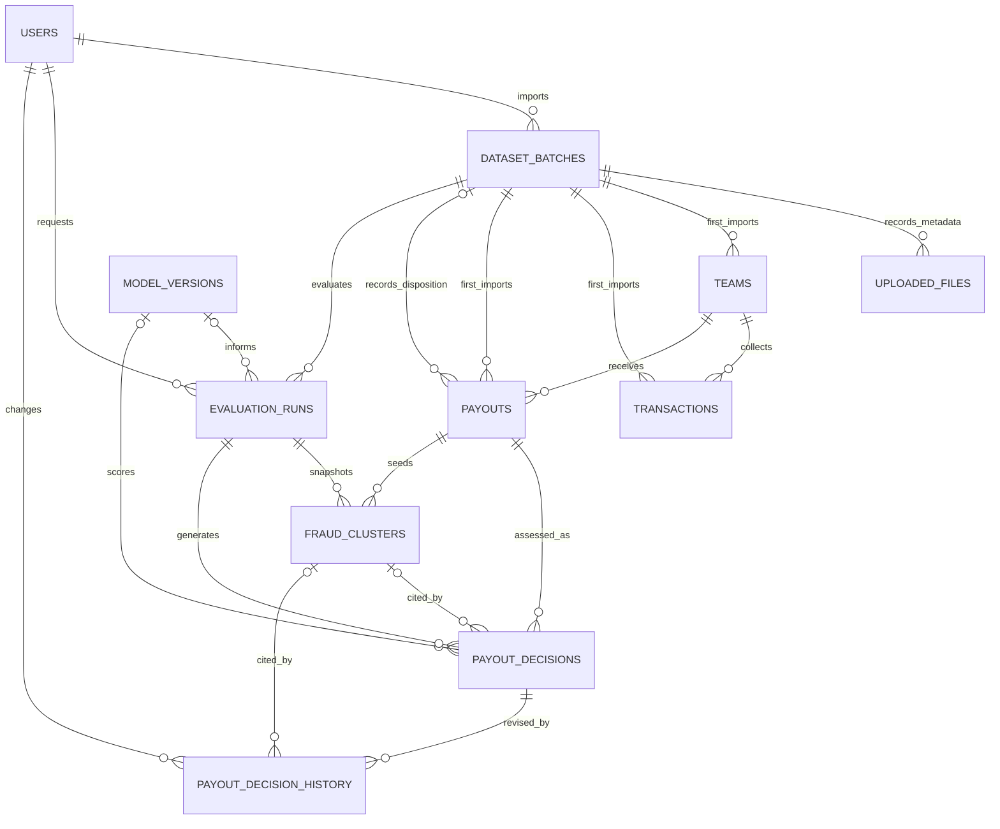

# Payout Risk Desk database design

The eleven application tables are defined in the `0001_database_first` Alembic revision. PostgreSQL is the source of truth in both private local and isolated synthetic Neon environments. CSVs are transient ingestion inputs. Every source column maps to a typed relational column, with monetary values in integer cents. Upload metadata and source membership identify accepted records. Sign-in and account-wide revocation use `users.auth_version`.

## Source files and column mapping

| File type | Destination |
| --- | --- |
| `2_history/teams.csv` | teams |
| `2_history/transactions_history.csv` | transactions |
| `3_action_day/transactions_10nov.csv` | transactions |
| `2_history/payouts_history.csv` | payouts |
| `3_action_day/payouts_pending.csv` | payouts |

Later filenames may differ. The selected file type, not the filename, determines its schema. Read both transaction files into the same table, and both payout files into the same table. All source columns are retained in typed form.

### teams

| Source field | Column / type |
| --- | --- |
| team_id | team_id text PK |
| team_name | team_name text |
| profession | profession text, supported enum |
| owner_name | owner_name text |
| owner_phone | owner_phone text |
| business_address | business_address text |
| city | city text |
| state | state text |
| onboarded_on | onboarded_on date |
| status | status text (active/suspended) |
| suspended_on | suspended_on date nullable |
| payout_bank_routing | payout_bank_routing text |
| payout_bank_last4 | payout_bank_last4 text |
| signup_device_id | signup_device_id text nullable |

Additional: first_import_batch_id FK, ingested_at timestamptz. No automatic team deletion or overwrite. Identical normalized rows are idempotent; conflicting existing team attributes are rejected with a correction-required error in this MVP. A future versioned master-data correction workflow is explicitly outside this release. Suspension status is source business status, not a generic ML eligibility flag.

### transactions

| Source field | Column / type |
| --- | --- |
| txn_id | txn_id text PK |
| team_id | team_id text FK |
| created_at_ist | created_at timestamptz, collection_date_ist date derived |
| amount_usd | amount_cents bigint |
| tip_usd | tip_cents bigint |
| payment_method | payment_method text enum card/tap_to_pay/ach |
| card_fingerprint | card_fingerprint text nullable |
| card_country | card_country text nullable |
| status | status text enum captured/declined/refunded |
| customer_name | customer_name text |
| customer_zip | customer_zip text |

Additional: first_import_batch_id FK, ingested_at. Identical IDs and values are no-ops; conflicting transaction IDs reject the upload. A changed/refunded transaction snapshot requires a future controlled correction mechanism; never silently mutate financial history. Preserve source IDs, leading zeros and optional nulls. No irreversible case normalization of stored personal names; derive normalized match keys in code.

### payouts

| Source field | Column / type |
| --- | --- |
| payout_id | payout_id text PK |
| team_id | team_id text FK |
| created_at_ist | created_at timestamptz, created_date_ist date derived |
| covers_from | covers_from date |
| covers_to | covers_to date |
| txn_count | txn_count integer |
| payout_amount_usd | payout_amount_cents bigint |
| decision (history only) | historical_decision text nullable |
| decided_by (history only) | historical_decided_by text nullable |
| decided_at_ist (history only) | historical_decided_at timestamptz nullable |
| reason_code (history only) | historical_reason_code text nullable |
| reason (history only) | historical_reason text nullable |
| status (pending only) | source_status text nullable (PENDING_DECISION) |

Additional: first_import_batch_id FK, first_source_kind HISTORY/PENDING, disposition_import_batch_id FK nullable, disposition_recorded_at timestamptz nullable, ingested_at. Historical status and app decision are separate. For initially historical rows require historical decision and timestamp; for newly pending rows require PENDING_DECISION. A later verified history import may fill a previously pending payout's historical disposition once if immutable financial fields match, decision timestamp is valid and no prior disposition exists. Preserve first_source_kind and original source_status for provenance, and never replace original ML/analyst decisions. Repeat identical disposition is no-op, conflicting disposition is rejected. Record the disposition import batch/time. All other conflicting financial data is rejected. A pending candidate is a payout identified by the selected batch's pending membership, with no historical disposition known in the run snapshot. Historical membership derives from disposition availability, not a mutable application flag.

## Application tables

| Table | Key columns and responsibilities |
| --- | --- |
| users | user_id UUID PK, username unique, password_hash, display_name, role ADMIN/ANALYST/VIEWER, is_active, auth_version, created_at. Authenticated identity; no plaintext credentials. |
| dataset_batches | batch_id UUID PK, scope_key, uploaded_by FK users, mode INITIAL/INCREMENTAL, cutoff_at timestamptz, status UPLOADED/VALIDATING/READY/FAILED, input_digest, imported_at, error_summary JSONB. Unique scope+digest for successful import. |
| uploaded_files | file_id UUID PK, batch_id FK, file_type, sanitized filename, sha256, bytes_count, row_count, inserted_count, unchanged_count, validation_summary JSONB, imported_source_ids JSONB. Unique batch+file_type. Metadata and typed membership IDs only; no file content or CSV bytes. Pending membership includes every submitted valid payout ID including identical duplicates from earlier batches. |
| model_versions | model_version_id UUID PK, training_fingerprint, algorithm, feature_schema_version, config JSONB, fit/validation cutoffs, counts, threshold, metrics JSONB, status, created_at. Metadata only, no serialized model or training vectors. Unique scope+fingerprint+config; keep scope_key. |
| evaluation_runs | run_id UUID PK, batch_id FK, scope_key, requested_by FK users, model_version_id FK nullable, cutoff_at, snapshot_at, input_digest, rule_version, status QUEUED/RUNNING/COMPLETED/FAILED, timestamps, sanitized error, history_manifest JSONB and summary JSONB. Manifest records selected pending IDs, eligible training IDs, historical monitoring and fraud evidence IDs, disposition versions/batch IDs, source digest and configuration; no raw rows. Persist the historical monitoring aggregate and window in the run summary so later imports cannot alter an older run’s displayed history. |
| fraud_clusters | cluster_id UUID PK, stable_case_key text, run_id FK, canonical seed_payout_id FK, reason_code, summary, typed evidence JSONB. Unique run+stable_case_key; immutable per run; same known case key across runs when supported. |
| payout_decisions | decision_id UUID PK, run_id FK, payout_id FK, model_version_id FK nullable, decision, cluster_id FK nullable, reason, evidence JSONB, findings JSONB, ml_score nullable float, ml_is_anomaly nullable boolean, ml_status, rule_version, created_at. Unique run+payout. Immutable automated version 1. |
| payout_decision_history | history_id UUID PK, decision_id FK, scope_key, version integer >=2, previous_decision, new_decision, cluster_id FK nullable, change_reason, evidence JSONB, changed_by FK users, created_at. Unique decision+scope+version. Append-only. |

There are 3 source tables + 8 application tables = 11. Use `APPROVE`, `MANUAL_REVIEW`, `REJECT` internal codes; cluster required iff Reject. Nonblank reasons and typed evidence references; validate cluster belongs to run and link is established. User-supplied changed_by is not accepted. Source historical actor is separate from authenticated app actor. Findings include team/profession comparisons, counts, thresholds, evidence paths and ML quality-gate/influence details. Use original decision version 1 and latest event version as the effective state. Expose `decision_source` AUTOMATED/HUMAN, `record_status` CURRENT/SUPERSEDED derived from selected scope/version; no physical is_current updates. Original and previous rows never change. Batch/run statuses may change because they are workflow state, not decision history.

## ER diagram

## Import and evaluation transactions

The input digest uses SHA-256 checksums keyed by declared file type, mode, UTC cutoff, and assessment flag. Renaming or reordering parts preserves the digest. Changing CSV bytes can create a new batch whose identical normalized records are counted as unchanged. Membership stores unique typed IDs, while row counts include repeated identical rows. Completed dispositions have their own count in validation metadata.

`UPLOADED` and `VALIDATING` are intermediate states inside the import transaction. Concurrent readers see the committed `READY` batch or a separately recorded `FAILED` batch. A crash before commit rolls back source rows and releases the advisory lock. Recording `FAILED` depends on PostgreSQL availability. Retrying the same input after commit returns the existing batch.

Historical windows with unavailable boundary days or a captured total that differs from the supplied payout are flagged with typed payout IDs in file validation metadata. Later snapshot queries should reevaluate completeness because an incremental history import can add missing attempts. Pending reconciliation uses prior and staged captured attempts. Payment attempts of all statuses remain stored.

Validate bounded multipart streams in memory or temporary local files, remove temporary files on success/failure. Accept initial five files or later transaction and pending pair with optional new teams and historical dispositions/history. Read file types and headers; validate normalized records, dates, keys, references, money, duplicate/conflicting values and cutoff; reconcile pending captured count and cents using existing DB plus staged rows. Transaction-scoped advisory lock serializes imports; atomically insert accepted source rows and membership metadata, then mark READY. Roll back all source writes on any invalid file; retain sanitized FAILED metadata separately. Do not allow a partially valid batch. Record imported IDs, not raw records in metadata. Use source-ID uniqueness and content digest for idempotency; no duplicate rows or duplicate evaluation on retry. Initial assessment mode asserts 24 teams and 20 payouts, general mode has no fixed count. Require pending payouts in one import batch to share an IST creation day; split different creation days into separate batches.

Evaluate only READY batches using explicit cutoff and a consistent PostgreSQL REPEATABLE READ snapshot. Materialize eligible historical rows and selected pending membership into in-process feature structures; release snapshot before CPU fit if necessary, and freeze the snapshot manifest and digest. Do not use CSVs again. Serialize publication per run/digest; insert model metadata, run clusters and every decision together and mark COMPLETED only when count/IDs reconcile. Failed runs expose sanitized status, never a partial decision set. Prior runs stay readable. Reuse same completed run for same batch/snapshot/config; changed data or config creates new run explicitly. Previous analyst overrides stay attached to prior run and are never silently carried into fresh automated runs; UI warns and offers prior history. Select run explicitly for queue, dashboard, detail and export. Do not silently switch the active view.

## Evaluation input boundary

Pending observations reuse transaction attempts first accepted by the selected batch's committed import boundary. The snapshot joins each attempt to its first READY import in the same dataset scope and compares that batch's `imported_at` with the selected batch's `imported_at`. The ingestion lock serializes these markers, which PostgreSQL now stamps after lock acquisition. Later backfills can improve historical coverage without changing the attempts of an older pending batch. Source `ingested_at` remains provenance because a transaction waiting for the lock can have an earlier transaction-start timestamp. The snapshot rechecks pending count and cents after applying the import boundary.

Historical observations and verified dispositions may use newer READY imports visible to the evaluation snapshot. The historical payout decision time must be at or before the selected cutoff. A newly visible verified disposition can explicitly exclude a selected pending payout from a new snapshot. The manifest retains original selected membership and the exclusions. An empty eligible set fails preparation.

Evaluation input preparation uses a read-only REPEATABLE READ transaction and materializes inputs before release. The SHA-256 fingerprint includes ordered source values, provenance, cutoff, eligibility, monitoring, and version configuration. The snapshot timestamp is recorded separately. JSONB stores membership references, disposition provenance, and historical monitoring aggregates. Private source values stay in memory. A batch-and-fingerprint advisory lock coordinates run creation. Row locks coordinate claiming and failing existing runs. Preparation can create QUEUED rows, claim them as RUNNING, and persist FAILED outcomes. Retrying a failed fingerprint creates a new row. Phase 9 owns atomic completion. The manifest survives the transaction, and PostgreSQL releases the snapshot when that transaction ends. This phase has no interrupted-worker recovery.

## Override transaction and indexes

Resolve user and authorized scope server-side; lock original decision row, get latest event version for that scope, compare expected_version (409 if stale), validate decision/reason/evidence/cluster, insert next version (201). A no-op decision change can return 422. Do not UPDATE either immutable decision table; DB role/trigger protections and tests where practical. Use latest event projection for all reads and export in a consistent SQL snapshot; original remains visible. Non-Reject effective cluster is null even if prior Reject existed. Local authenticated users share local review scope; hosted reviewer account scopes isolate overrides, while common seeded synthetic automated decisions are readable by authorized demo users. Hosted arbitrary file upload disabled; controlled synthetic imports/evaluations admin only. No cross-scope user data access.

Indexes: transactions(team_id, collection_date_ist), transactions(card_fingerprint), payouts(team_id,covers_from,covers_to), payouts(created_date_ist), payouts(historical_decided_at), uploaded_files(batch_id,file_type), evaluation_runs(batch_id,status), payout_decisions(run_id,payout_id), payout_decision_history(decision_id,scope_key,version DESC). All timestamps are timezone-aware; IST source dates explicit. Sensitive columns and historical free text are private; API allowlists exclude owner/customer names, raw phone, bank, device, card and raw private notes; expose sanitized typed evidence and minimal operational context. No raw CSV, source values in logs, or model binaries in DB. Backups private only.

The unique keys serve file-type, run/payout and decision-history lookups. PostgreSQL can scan the scoped history key backward to obtain the latest version. Card fingerprint and historical disposition indexes exclude nulls. Partial unique indexes deduplicate ready imports by scope and digest, and completed runs by batch and digest.

The initial migration blocks updates, deletes and truncation of original decisions, their history, and run-specific clusters. It also enforces the next version and matching previous outcome within each review scope, same-run cluster references, and one-time completion of an imported pending payout’s historical disposition. Use a separate migration role to own the schema in deployed environments; the application will enforce user authorization, scope and evidence relevance when those workflows land.
