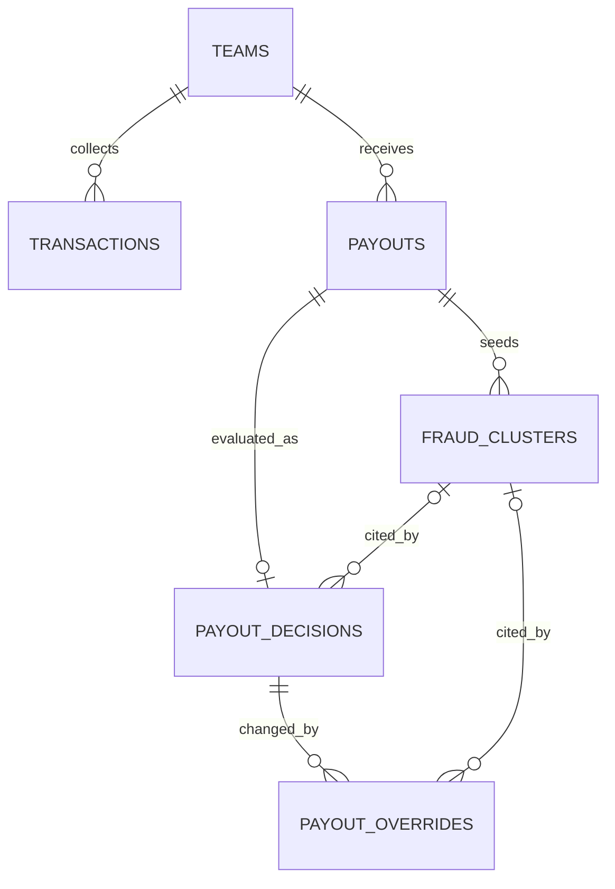
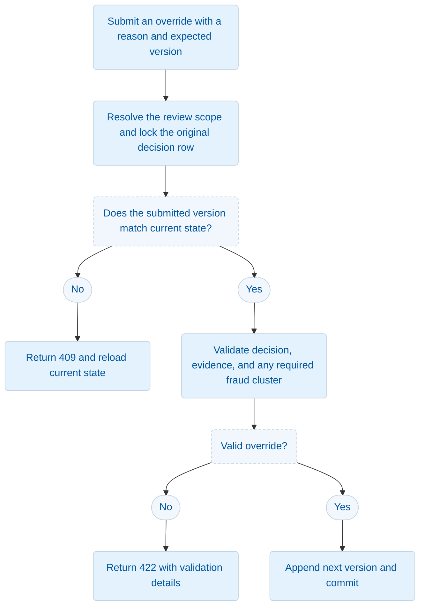

# Payout Risk Desk database design

Use the same PostgreSQL schema in the private local run and the Neon synthetic demo. Each database holds one dataset. The five CSVs map to three source tables. Three additional tables hold known fraud cases, original decisions (including statistical and ML findings), and override events. No dedicated model or feature tables are needed for this single-batch architecture.

## Source files

I checked all five supplied headers. Their names and column order match the brief. The two transaction files have identical headers. The pending payout file has `status` in place of the five historical decision fields. This check covered headers only. Input values, keys, counts, and payout totals are verified during the private local run.

| File | Destination and source columns |
| --- | --- |
| `2_history/teams.csv` | `teams` — `team_id, team_name, profession, owner_name, owner_phone, business_address, city, state, onboarded_on, status, suspended_on, payout_bank_routing, payout_bank_last4, signup_device_id` |
| `2_history/transactions_history.csv` | `transactions` — `txn_id, team_id, created_at_ist, amount_usd, tip_usd, payment_method, card_fingerprint, card_country, status, customer_name, customer_zip` |
| `3_action_day/transactions_10nov.csv` | `transactions` — same header as the historical transaction file |
| `2_history/payouts_history.csv` | `payouts` — `payout_id, team_id, created_at_ist, covers_from, covers_to, txn_count, payout_amount_usd, decision, decided_by, decided_at_ist, reason_code, reason` |
| `3_action_day/payouts_pending.csv` | `payouts` — `payout_id, team_id, created_at_ist, covers_from, covers_to, txn_count, payout_amount_usd, status` |

The brief lists 24 teams, historical collections from 21 October through 9 November 2026, and historical payouts created 23 October through 11 November. The action files cover 10 November collections and the 20 payouts created on 12 November at 5:30 PM IST.

## Relationships

- The `team_id` in each transaction and payout references `teams.team_id`.
- The transaction headers contain `team_id` and `txn_id`. Match transactions to a payout using the team and inclusive IST collection dates. This is a coverage query over source fields.
- The cluster's `seed_payout_id` references the canonical historical fraud rejection; additional merged seeds are retained in typed supporting IDs. Other historical and pending evidence can refer to source transactions, payouts, or teams.
- `payout_decisions.payout_id` is both PK and FK. A historical payout has no generated decision. A pending payout has exactly one after publication.
- One generated decision can have multiple overrides. Each original or override decision references a cluster exactly when its decision is Reject.

## Source tables

Store source IDs, ZIP codes, bank routing numbers, and account last-four values as text to preserve leading zeros. Parse USD decimals into `bigint` cents. Treat the source timestamps as IST when no offset is supplied. Store instants as `timestamptz` and derive IST calendar days as `date`.

| Table | Stored fields | Source handling |
| --- | --- | --- |
| `teams` | `team_id text PK`, name, profession, city, state, onboarding date, status, suspension date, optional normalized phone, routing, last four, and device ID | `status` is `active` or `suspended`. Owner name and business address stay in the private source. Use device, phone, and partial bank matches as leads that require case evidence. |
| `transactions` | `txn_id text PK`, `team_id FK`, payment instant, IST collection date, amount and tip in cents, payment method, status, nullable card fingerprint and country, optional ZIP | Both files use the same columns. Methods are `card`, `tap_to_pay`, and `ach`. Statuses are `captured`, `declined`, and `refunded`. Map blank fingerprints to SQL `NULL` and skip them when matching. Customer name stays in the private source. |
| `payouts` | `payout_id text PK`, `team_id FK`, creation instant and IST date, coverage start/end, captured count, amount in cents, `source_kind`, historical decision, decision actor/time and reason code, pending source status | A `HISTORY` row has `AUTO_APPROVED`, `MANUAL_APPROVED`, or `REJECTED` and no pending status. A `PENDING` row has `PENDING_DECISION` and no historical decision fields. Detailed historical reasons are read locally when examining cases. Keep source status unchanged after the app publishes its decision. |

Index `transactions(team_id, collection_date_ist)` for covered attempts and non-null `transactions(card_fingerprint)` for identifier lookups. Index `payouts(source_kind, created_date_ist)` for the queue and historical comparisons. The override primary key supports scoped version lookups.

Count and sum captured rows only for payout reconciliation. Include declined and refunded rows in the matched attempts when a risk feature needs them. Require the action batch to reconcile to the supplied count and cents before publishing. Exclude incomplete historical coverage from features that need a full window.

## Application tables

| Table | Fields and purpose |
| --- | --- |
| `fraud_clusters` | `cluster_id text PK`, `seed_payout_id FK`, reason code, summary, and typed supporting IDs. The seed must be a historical `REJECTED` payout with a fraud reason known by the cutoff. |
| `payout_decisions` | `payout_id PK/FK`, decision, optional `cluster_id FK`, reason, evidence, findings, evaluation timestamp, rule version, and input digest. Immutable after publication. Findings retain observed and baseline values, sample counts, thresholds, case links, and ML evaluation metadata used in the decision. |
| `payout_overrides` | `payout_id FK`, `scope_key text`, version, decision, optional `cluster_id FK`, reason, evidence, and creation timestamp. The payout foreign key targets `payout_decisions.payout_id`. The PK is `(payout_id, scope_key, version)`. The original is version 1 and overrides start at 2. |

Use the internal decision codes `APPROVE`, `MANUAL_REVIEW`, and `REJECT`. Require nonblank reasons and enforce cluster presence exactly when the decision is `REJECT`. Keep findings and typed evidence arrays in `jsonb`. Each evidence entry has a `type` of `team`, `transaction`, or `payout` and a source `id`. The service verifies that the record exists and supports the finding or override. PostgreSQL foreign keys enforce links between tables. Omit raw customer, owner, device, bank, and card identifiers from API responses and logs.

## Risk and ML findings

Keep the six-table design. Add no model-specific table for this single published batch. Persist ML metadata in the existing immutable `payout_decisions.findings` JSONB object. A consistent batch-level metadata summary is embedded in each original decision; the dashboard can read it from the published batch without fitting a model again. Store typed evidence IDs for every decision-influencing finding. Do not store raw card, device, bank, owner or customer values in findings or API-visible case summaries.

| JSON key in `findings` | Content |
| --- | --- |
| `statistics` | Structured team and profession deviations, baseline values and bounds, comparison windows, sample counts, thresholds and supporting IDs. |
| `fraud` | Confirmed/candidate links, matched cluster IDs and supporting typed records; evidence paths use source record IDs and identifier *types*, not raw sensitive identifier values. |
| `ml` | Status (`ACTIVE`, `DIAGNOSTIC_ONLY`, `INSUFFICIENT_HISTORY`, `VALIDATION_FAILED`, `INFERENCE_FAILED`), score and threshold when available, anomaly flag, decision-influence flag, evidence-backed explanation, and sanitized fallback reason if applicable. |
| `model_metadata` | Algorithm, model/config/feature schema versions, random seed, training/validation windows and counts, feature list, validation metrics/gate outcome and final fit window. No serialized estimator, private file path, or raw training data. |

`ACTIVE` means the model is eligible to affect Manual review, not that the specific payout was flagged. `DIAGNOSTIC_ONLY` can hold a computed score that did not pass the decision-use gate or has no actionable explanation. Null denotes unavailable scores; never use zero as a placeholder. The historical labels are imperfect; retain measured validation metrics without presenting them as confirmed ground truth. Version model and threshold settings alongside rule configuration in the evaluation digest. Persist per-payout inference results for the original decision, including cases where fraud takes precedence. Overrides never modify original model findings. A verified override can inform a future batch only after explicit review; the current model is not retrained on reviewer clicks.

Fitted artifacts and preprocessing objects, if saved, are written to a private local artifact directory for real inputs, or a separate synthetic artifact directory for the demo. They are not stored in PostgreSQL, committed, or served by HTTP. Inference runs before atomic batch publication; hosted read and override endpoints never load untrusted model files. No new table or API is required for model metadata.

## Publish and validate

Run the five-file checks locally. Validate IDs and references, supported enums, IST dates, captured count and amount, and completeness of the 20 generated decisions. In one transaction, insert teams, transactions, payouts, clusters, and original decisions in dependency order. Serialize seed commands with a transaction-scoped advisory lock. Compute a deterministic digest from the five source inputs, any locally approved case mappings, risk rules, feature/model configuration and versioned validation policy. Repeating the same digest preserves existing decisions and overrides. A different input or evaluation-policy digest requires a separate database for the new published snapshot (including a changed model configuration); never overwrite the original decisions. Record the actual model status and validation results in the findings. Do not include wall-clock times in the digest. Failed validation leaves prior state intact.

## Effective decisions and overrides

Read the newest override version for the current payout and review scope. If no override exists, use the original decision at version 1. Read the cluster from the selected row, including when it is null. Use this same projection for the detail view, queue, dashboard, and export. Classify an effective approval from an override as analyst-approved.

Resolve the scope server-side. Lock the original decision, read the latest version for that scope, validate the change, and append the next version in one transaction. The event history and original decision show what changed. Export the entire pending batch from one SQL statement so every row comes from a consistent view, even during a concurrent override.