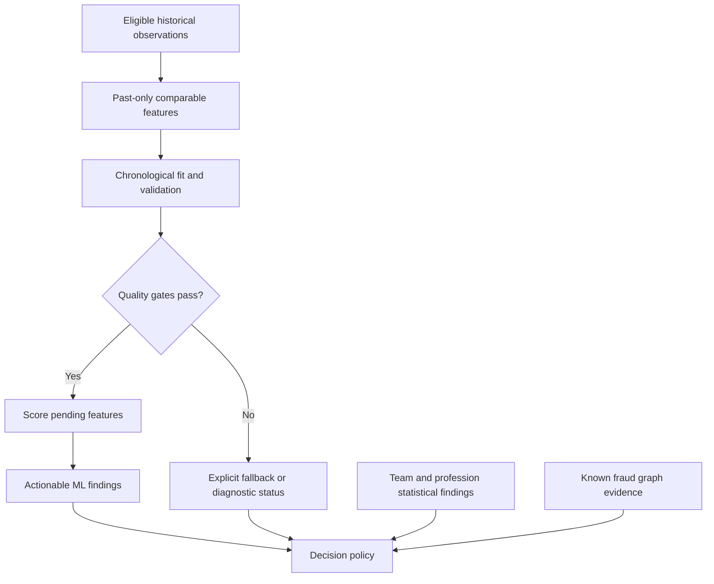

# Payout Risk Desk risk engine design

The risk engine runs in an explicit evaluation service invoked by local CLI or an authorized UI request. PostgreSQL is its only source of risk data; files are not queried after import. It combines graph-based known-fraud detection, robust statistical comparisons, and a required Isolation Forest pipeline. The API reads the published results and never retrains. See [system design](system-design.md) and [database design](database-design.md) for deployment and persistence.

## Inputs and trust boundaries

Use the selected READY import batch and explicit run cutoff (initial assessment: 13 November 2026 10:00 IST). Read accepted source rows and known dispositions in a consistent REPEATABLE READ snapshot; freeze membership, snapshot time, cutoff and digest. Active means accepted and available to this run, not team.status=active. No raw file retention. The local developer verifies actual records and historical reasons privately; only synthetic records enter automated development or hosted demos. Join covered attempts by team and inclusive IST collection dates; captured amount plus tip and count must reconcile exactly before publication. Declined and refunded attempts remain available for analysis. Exclude incomplete historical windows from features requiring complete coverage. Use only outcomes known by the relevant historical cutoff. No pending records in training or threshold tuning.

## Features and statistical learning

Use a consistent observation unit (comparable payout windows or team-days). Treat weekend coverage explicitly. Maintain typed supporting IDs for every feature and comparison. Avoid raw identifiers in feature vectors and findings.

| Feature | Definition |
| --- | --- |
| Captured amount | Sum captured amount and tip in cents |
| Captured count | Number of captured attempts |
| Typical / largest payment | Median / maximum captured base amount in cents |
| Decline rate | Declined attempts divided by all covered attempts |
| Tip ratio | Captured tips divided by captured base amount |
| Distinct cards | Count of nonblank card fingerprints |
| Additional patterns | Repeated cards, attempt bursts, refund rate, payment method/country mix where supported |
| Relative features | Current values relative to earlier team and profession medians or meaningful spread |

For rates/ratios, define denominators, minimum attempts, null vs zero and zero-baseline handling. Compute team and leave-subject-team-out profession baselines from eligible approved history; exclude confirmed fraud and contaminated feature slices. Preserve verified legitimate context, including victims' legitimate captures when supported. Use median, quartiles/IQR, minimum sample count and material absolute/relative effect gates. Starting thresholds must be configurable and explicitly identified as engineering assumptions. Zero spread needs minimum absolute change, not division by zero. Evaluate both baseline scopes when reliable; use profession fallback if team sparse; route material remaining uncertainty to review. Each finding stores metric, observed value, baseline range, sample count, coverage, threshold, supporting IDs and actionable reason.

## Known fraud clusters

Seed on historical REJECTED payouts with cutoff-known `FRAUD_CARD_RING`, `FRAUD_CARD_TESTING`, `FRAUD_ACCOUNT_TAKEOVER`. Read historical reasons locally and identify actually implicated records. Where deterministic parsing is insufficient, the developer reviews a local case mapping and the service validates the links. Do not infer every card associated with a rejected team is fraudulent.

Build typed NetworkX graph nodes for cases, teams, transactions and meaningful identifiers. Preserve source-record provenance on every edge. Merge case seeds only through supported strong links, using connected components, canonical seed and deterministic cluster ID. A current payout needs its own evidence path to the known case. Blank values never match. Shared device, phone, partial bank identifiers are leads requiring corroboration; common bank, name, geography, profession, generic behaviour or a legitimate common customer do not establish fraud. Never propagate fraud through a victim or weak edge. Distinguish declined attempts from captured fraud exposure and prior remediated account takeover from current exposure. Choose strongest supported cluster; tie by cluster ID. Retain alternate matches internally. Case summaries and paths use typed source IDs and identifier types rather than raw identifiers. Similarity alone triggers review only when meaningful.

## Required ML pipeline: Isolation Forest

The brief does not require a particular ML model; the project explicitly requires implementation of this one. No default-off model. Train, validate and score eligible payouts during normal batch evaluation. Use one pooled model on comparable feature vectors and relative features; not 24 undersized models. Implement preprocessing, training, evaluation and inference as separate testable functions.

1. Construct historical vectors with strictly earlier available baselines, no self/future leakage. No PII, IDs or outcome labels as input features. Use approved eligible history for fitting. Reserve later eligible history (including verified unusual cases where meaningful) for validation; clearly document exclusion rules.
2. Fit preprocessing on training only. Handle missing features, minimum sample count and feature coverage. Initial settings: `n_estimators=100`, `max_samples='auto'`, `contamination='auto'`, `random_state=42`. These are proposals, not tuned or validated parameters.
3. Evaluate on later observations against statistics-only baseline. Declare configurable sample/coverage/workload/actionability gates before validation. Report actual sample counts, review rates, verified-outlier detection, apparent normal alerts and flagged dollar exposure where calculable. Historical labels are imperfect; no unsupported accuracy or fraud probability claims. Do not optimize on the pending batch.
4. Fit final model on eligible pre-action history if using a compatible threshold calibration policy; otherwise retain the validated fitted model. Record exact threshold policy and fit window. Score all eligible pending records with identical feature construction and fitted preprocessing. Use `-score_samples` (larger means more unusual), not a probability.
5. Explain meaningful model flags using observed feature combinations, comparison values and supporting source IDs. Statistical deviation context is not formal model attribution. Only validated, material, actionable ML findings can cause Manual review. Diagnostic-only signals do not change decisions. ML never authorizes Reject.
6. Persist `ml` and `model_metadata` inside immutable payout_decisions fields/findings and model_versions metadata. Expose status and sanitized reasons. `ACTIVE` = eligible for decision influence; `DIAGNOSTIC_ONLY` = available score but no actionable/validated influence; `INSUFFICIENT_HISTORY`, `VALIDATION_FAILED`, `INFERENCE_FAILED` = explicit fallback conditions. Null score if unavailable. Failed quality gates never fabricate a score or silently disable the model. Use statistical/fraud fallback and review material uncertainty.

Version feature schema, configuration, algorithm, seed, cutoff, fit/validation windows, gate outcome, actual metrics and threshold. Include model configuration/version in evaluation digest; do not include wall-clock time. Fitted artifacts, if saved, stay in separate local private or synthetic storage, not Git, API or database.

## Final classification and explanations

| Established known exposure | Meaningful statistical / actionable ML / unresolved risk | Outcome |
| --- | --- | --- |
| Yes | Either | REJECT, with known cluster and evidence |
| No | Yes | MANUAL_REVIEW, with evidence and next action |
| No | No | APPROVE, with normal-behaviour context |

An invalid batch blocks publication; no artificial fourth CSV decision. Retain all findings even if fraud takes precedence. Generate one or two plain-English sentences from deterministic templates and actual evidence. Validate IDs and relevance. Preserve immutable original decisions per run; scoped authenticated overrides append new events with actor, reason and version. A later run cannot alter earlier decisions. Only verified historical dispositions imported from trusted sources may feed future training; never retrain on unverified reviewer activity. No LLM or supervised fraud classifier needed.

## Acceptance checks

Test normal and unusual behaviour at both scopes, sparse and zero baselines, multi-day comparability, missing identifiers, unrelated clusters, direct and corroborated exposure, victim cases, leakage-free features, reproducible model fit/score, actionable ML-only review, no ML-only rejection, fallback and metadata persistence, full reconciliation and correct decision CSV. Synthetic expected labels must be independently specified. Actual performance and fraud findings remain unverified until the developer runs the actual datasets privately.

## Database-first lifecycle and model reuse

Evaluation inputs distinguish three uses of history. Complete, comparable approvals are normal-behaviour candidates. A cutoff-known rejection with a supported fraud code can seed an investigation even if its transaction coverage is incomplete. Monitoring includes all cutoff-known historical outcomes in the preceding 20 IST payout-creation dates. Candidate eligibility precedes feature-level contamination checks and model validation. Monitoring labels weekends without scheduled payouts separately from weekdays with unknown source coverage. It stores counts and integer cents by disposition, source IDs, and coverage denominators.

Read source rows using repositories; pure feature/model functions receive typed in-memory observations, never file paths. Only historical approvals with disposition known by cutoff and imported by snapshot are candidates for normal training. Pending payouts may later become historical only via verified disposition import; automated Approve and analyst overrides are not historical ground truth. Suspended teams can contribute legitimate pre-suspension history if supported, and remain searchable for fraud evidence. Select the pending payout IDs from uploaded_files membership; do not score every database row or all prior pending batches. Retain prior runs for audit. Model fingerprint includes exact eligible observations and historical dispositions, feature schema, configuration, cutoff and policy. Persist model metadata and per-payout scores in PostgreSQL; optional trusted fitted artifact stays outside Git and DB. Reuse only an exact compatible model within its scope, otherwise train/refit. If no fitted artifact is available, deterministic refit is acceptable. No HTTP inference on every read. Store run manifest, model gate status and metrics; if training fails, retain explicit failure/fallback and publish valid evidence-backed decisions only. More records alone do not establish better accuracy.
