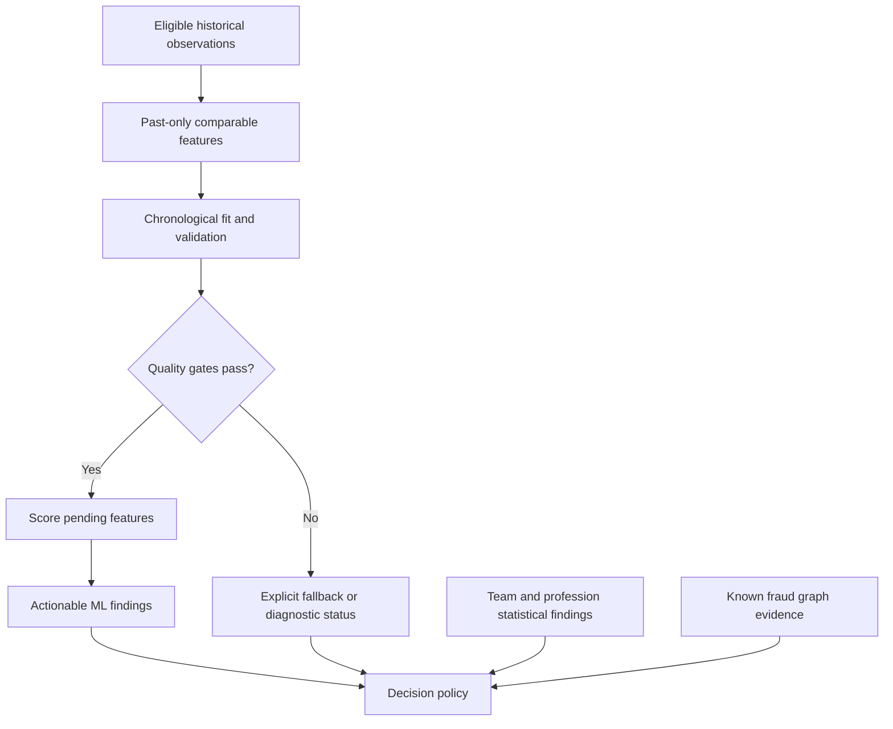

# Payout Risk Desk risk engine design

The risk engine runs in an explicit evaluation service invoked by local CLI or an authorized UI request. PostgreSQL is its only source of risk data; files are not queried after import. It combines graph-based known-fraud detection, robust statistical comparisons, and a required Isolation Forest pipeline. The API reads the published results and never retrains. See [system design](system-design.md) and [database design](database-design.md) for deployment and persistence.

## Inputs and trust boundaries

Use the selected READY import batch and explicit run cutoff (initial assessment: 13 November 2026 10:00 IST). Read accepted source rows and known dispositions in a consistent REPEATABLE READ snapshot; freeze membership, snapshot time, cutoff and digest. Active means accepted and available to this run, not team.status=active. No raw file retention. The local developer verifies actual records and historical reasons privately; only synthetic records enter automated development or hosted demos. Join covered attempts by team and inclusive IST collection dates; captured amount plus tip and count must reconcile exactly before publication. Declined and refunded attempts remain available for analysis. Exclude incomplete historical windows from features requiring complete coverage. Use only outcomes known by the relevant historical cutoff. No pending records in training or threshold tuning.

## Features and statistical learning

Use a consistent observation unit (comparable payout windows or team-days). Treat weekend coverage explicitly. Maintain typed supporting IDs for every feature and comparison. Avoid raw identifiers in feature vectors and findings.

| Feature | Definition |
| --- | --- |
| Captured amount | Sum captured amount and tip in cents |
| Captured count | Number of captured attempts |
| Typical / largest payment | Median / maximum captured base amount in cents |
| Decline rate | Declined attempts divided by all covered attempts |
| Tip ratio | Captured tips divided by captured base amount |
| Distinct cards | Count of nonblank card fingerprints |
| Additional patterns | Repeated cards, attempt bursts, refund rate, payment method/country mix where supported |
| Relative features | Current values relative to earlier team and profession medians or meaningful spread |

For rates/ratios, define denominators, minimum attempts, null vs zero and zero-baseline handling. Compute team and leave-subject-team-out profession baselines from eligible approved history; exclude confirmed fraud and contaminated feature slices. Preserve verified legitimate context, including victims' legitimate captures when supported. Use median, quartiles/IQR, minimum sample count and material absolute/relative effect gates. Starting thresholds must be configurable and explicitly identified as engineering assumptions. Zero spread needs minimum absolute change, not division by zero. Evaluate both baseline scopes when reliable; use profession fallback if team sparse; route material remaining uncertainty to review. Each finding stores metric, observed value, baseline range, sample count, coverage, threshold, supporting IDs and actionable reason.

### Phase 6 feature schema

`payout-features-v1` has one observation per payout, built from its accepted inclusive IST collection window. A comparison requires the same number of collection days and the same number of weekend days. This rule applies to amounts, counts, rates, maxima, medians, and diversity. Weekday one-day payouts and weekend-plus-Monday payouts use separate cohorts. The implementation leaves values in their original units.

| Feature | Unit | Definition, denominator, and supporting transactions |
| --- | --- | --- |
| `payout_cents` | Cents | Integer sum of captured base and tip, citing captured transactions |
| `captured_count`, `attempt_count` | Count | Captured transactions and all covered attempts respectively, citing the matching transactions |
| `median_captured_base_cents`, `max_captured_base_cents` | Cents | Median and maximum captured base amounts, citing captured transactions. No capture makes these features inapplicable. |
| `decline_rate`, `refund_rate` | Ratio | Matching attempts divided by all covered attempts, citing the numerator and denominator population. Default minimum is five attempts. |
| `tip_ratio` | Ratio | Captured tips divided by captured base cents, citing captures. Default minimum base is 1,000 cents. |
| `distinct_cards` | Count | Distinct fingerprints across covered Card and Tap to Pay attempts, citing those attempts |
| `repeated_card_attempts` | Count | Card and Tap to Pay attempts beyond the first occurrence of each fingerprint, citing all attempts for repeated fingerprints |
| `card_attempts`, `tap_to_pay_attempts`, `ach_attempts` | Count | Counts for the named method across all statuses, citing the matching attempts. The total attempt count is available as distribution context. |
| `distinct_card_countries` | Count | Number of distinct normalized issuing countries across Card and Tap to Pay attempts, citing those attempts |
| `dominant_card_country_share` | Ratio | Highest issuing-country frequency divided by the number of covered card attempts. Default minimum is five attempts. |
| `peak_attempts_per_window` | Count | Largest number of attempts within an inclusive rolling elapsed-time window, citing the earliest maximizing group on ties. The default window is ten minutes. |
| `<feature>_relative_team`, `<feature>_relative_profession` | Ratio | Signed difference from the corresponding reliable historical median divided by its absolute value, with baseline and current evidence kept separately |

Available zero, unavailable coverage or identifiers, inapplicable populations or zero denominators, and insufficient denominators are separate states. Any missing fingerprint makes card diversity and repetition unavailable for that payout. Any missing issuing country makes country diversity and concentration unavailable. ACH stays outside both populations. A window with no observed historical attempts is excluded from ordinary fitting even if its declared payout is zero. Payout evidence always includes its source ID.

### Chronological eligibility and configuration

Ordinary cohorts use complete, cutoff-known historical approvals. Verified outliers, volume spikes, and card-testing victim examples stay available as validation-only observations. Known fraudulent or unverified dispositions and incomplete windows are excluded from ordinary fitting. Later phases can supply a validated fraud exclusion with source knowledge and import availability timestamps. Neither the feature vectors nor the statistical findings expose the raw linkage values.

For each historical subject, the source cutoff for its baseline is the subject's payout creation time. Comparators must precede it strictly and have a disposition known at that time. The availability boundary is the subject's first committed import, capped by the selected database snapshot. Both attempts and observed collection dates respect that boundary, so a later backfill cannot change a previously constructed historical vector. Imports and historical events use separate clocks. Pending features use the accepted attempt boundary from Phase 5. Pending comparisons can use eligible history available to the run snapshot and known at the selected source cutoff. Completeness is checked through captured reconciliation and observed team date bounds. An observed range does not prove continuous provider coverage between its endpoints.

### Baselines, materiality, and findings

Team distributions give each comparable payout one vote. Profession distributions exclude the evaluated team, calculate a median within each sufficiently observed peer, then give each peer median one vote. Team estimates require five observations by default. Profession estimates require eight observations across two independent peers, with at least two observations per peer. The finding includes raw counts, contributing peer counts, coverage, collection period, and source references. Quartiles use linear interpolation at `(n - 1) × percentile`. Reliable distributions use Q1, median, Q3, and IQR. The default fences use 1.5 times IQR.

| Feature | Direction | Minimum absolute departure from median | Minimum relative departure |
| --- | --- | --- | --- |
| Payable amount | Both | 5,000 cents | 25% |
| Captured count | Both | 3 | 30% |
| Attempt count | High | 4 | 35% |
| Median captured base | Both | 2,500 cents | 30% |
| Maximum captured base | High | 5,000 cents | 30% |
| Decline rate | High | 15 percentage points | 50% |
| Refund rate | High | 10 percentage points | 50% |
| Tip ratio | High | 15 percentage points | 50% |
| Repeated-card attempts, peak attempt count | High | 3 | 50% |
| Distinct cards, method counts, country diversity and concentration | Diagnostic | — | — |

A meaningful outlier must cross its configured fence and pass both materiality gates when the median is nonzero. A zero median uses the absolute gate and leaves relative deviation unavailable. Zero IQR produces a fence at the median and applies the same materiality gates. The service retains both comparisons, prefers team history when reliable, and selects profession history when team history is sparse. Sparse comparisons at both scopes are explicit. Explanations use actual observed values, fences, medians, and source evidence. These defaults are engineering assumptions for synthetic verification.

The Phase 8 contract carries 48 ordered numerical positions, with each of the 16 base measurements followed by its team and profession relative values. An aligned availability tuple preserves missingness. Observation clocks, eligibility and source evidence remain separate from the vector. Phase 6 contributes its feature version and policy digest to the existing evaluation fingerprint. It performs read-only analysis and leaves model fitting, preprocessing and publication to subsequent phases.

## Known fraud clusters

Seed on historical REJECTED payouts with cutoff-known `FRAUD_CARD_RING`, `FRAUD_CARD_TESTING`, `FRAUD_ACCOUNT_TAKEOVER`. Read historical reasons locally and identify actually implicated records. Where deterministic parsing is insufficient, the developer reviews a local case mapping and the service validates the links. Do not infer every card associated with a rejected team is fraudulent.

Build typed NetworkX graph nodes for cases, teams, transactions and meaningful identifiers. Preserve source-record provenance on every edge. Merge case seeds only through supported strong links, using connected components, canonical seed and deterministic cluster ID. A current payout needs its own evidence path to the known case. Blank values never match. Shared device, phone, partial bank identifiers are leads requiring corroboration; common bank, name, geography, profession, generic behaviour or a legitimate common customer do not establish fraud. Never propagate fraud through a victim or weak edge. Distinguish declined attempts from captured fraud exposure and prior remediated account takeover from current exposure. Choose strongest supported cluster; tie by cluster ID. Retain alternate matches internally. Case summaries and paths use typed source IDs and identifier types rather than raw identifiers. Similarity alone triggers review only when meaningful.

### Phase 7 evidence and relationship policy

The internal service analyzes the same snapshot and pending attempts as the statistics service. It accepts a historical seed only for a supported rejected disposition known by cutoff and available in the snapshot, with at least one explicitly implicated transaction in that payout's accepted window. Incomplete coverage can still support a specifically referenced transaction. Verified approvals and victim records provide context.

The deterministic reader recognizes these affirmative directives when supplied on their own lines.

```text
implicated transaction: FICTIONAL-TXN-1
implicated card: FICTIONAL-CARD-1
implicated payout: FICTIONAL-PAYOUT-1
implicated team: FICTIONAL-TEAM-1
implicated owner phone: <local source value>
implicated signup device: <local source value>
implicated bank routing and last4: <routing>:<last4>
```

Transaction and card directives must resolve within the seed payout's accepted attempts. Payout and team directives must resolve to the seed and its team, and provide context. Profile directives must match the typed seed team fields. An invalid affirmative reference prevents automatic certification of that note. Quantified prose can support a same-day card ring or an earlier small-to-large sequence when the stated count and all named peers are corroborated. For supported testing descriptions, witnesses must be within two hours of a captured case anchor. A stated approximate IST clock time uses a 15-minute tolerance. A stated foreign card must have matching non-US issuer country codes on the anchor and witness records for the US assessment context. Private notes remain internal and ambiguous cases produce an unresolved seed. An optional local `CaseMapping` can provide a version, reviewed seed and transaction IDs, profile categories, and actual review availability. The service validates that all mapped witnesses were available by that review marker and in the selected snapshot. The caller supplies mapping contents privately as typed input. The run configuration retains the version and digest.

The NetworkX relationship graph separates historical cases, payouts, transactions, teams, cards, owner phones, signup devices, and combined routing/last-four keys. Case evidence is an explicit relation. Payout ownership, ordinary card sightings, and profile observations carry source references and separate event and availability times. Blank or missing keys are omitted. ACH contributes no card nodes. Phone normalization strips user-facing formatting while preserving digits and leading zeros. Device and card keys are trimmed and otherwise exact. Banks match on the combined normalized routing and last-four key. Raw key values stay inside the graph.

| Evidence | Treatment |
| --- | --- |
| Same explicitly implicated card in a captured payment at or after the implicated attempt | Direct exposure with a current-to-case graph path |
| Two distinct teams share both the explicitly implicated owner phone and signup device, with a historical implicated capture and a current capture at or after the verified decision | Corroborated exposure with separate evidenced paths for both identifiers |
| Same explicitly implicated card in a declined or refunded attempt | Unresolved risk tied to the specific attempt |
| A single profile match, bank pair alone, ordinary sightings of an unimplicated card, or prior involvement of the same team | Weak or incidental lead |
| Missing captured card evidence or missing usable verified card anchors, with no qualifying relationship | Insufficient evidence |
| Assessable captured card evidence with no qualifying relationship to a verified case | No supported exposure within the snapshot |

Verified victim teams and account-takeover seeds are excluded from the corroborated-profile rule. Direct evidence still requires a specific captured match. Routing alone, shared names, geography, and statistical findings have no exposure rule. Strong projection clustering uses only case-to-implicated-card certificates. Individual weak profile edges, incidental transactions, and victim observations stay outside the projection.

The stable key is a versioned SHA-256 digest of sorted historical seed payout IDs. The earliest verified decision time, followed by the payout ID, selects the canonical seed. Additional supporting evidence can preserve a key with unchanged members. A verified merge changes the key for future calculations and leaves previously published run snapshots intact. For multiple current matches, direct outranks corroborated, followed by the stable key. Each retained path uses allowlisted edge types and public evidence contains typed source IDs and identifier categories.

An otherwise eligible historical payout receives a Phase 6 contamination exclusion for a directly implicated captured card at or after the implicated event. The exclusion carries independent source knowledge and import availability dates. Weak links and non-payable victim activity leave historical eligibility intact. The statistics service recomputes pending comparisons from the same snapshot with these exclusions, and historical vectors use exclusions only when they meet both historical cutoffs. The output includes typed cluster drafts and findings for Phase 9 publication.

## Required ML pipeline: Isolation Forest

The brief does not require a particular ML model; the project explicitly requires implementation of this one. No default-off model. Train, validate and score eligible payouts during normal batch evaluation. Use one pooled model on comparable feature vectors and relative features; not 24 undersized models. Implement preprocessing, training, evaluation and inference as separate testable functions.

1. Construct historical vectors with strictly earlier available baselines, no self/future leakage. No PII, IDs or outcome labels as input features. Use approved eligible history for fitting. Reserve later eligible history (including verified unusual cases where meaningful) for validation; clearly document exclusion rules.
2. Fit preprocessing on training only. Handle missing features, minimum sample count and feature coverage. Initial settings: `n_estimators=100`, `max_samples='auto'`, `contamination='auto'`, `random_state=42`. These are proposals, not tuned or validated parameters.
3. Evaluate on later observations against statistics-only baseline. Declare configurable sample/coverage/workload/actionability gates before validation. Report actual sample counts, review rates, verified-outlier detection, apparent normal alerts and flagged dollar exposure where calculable. Historical labels are imperfect; no unsupported accuracy or fraud probability claims. Do not optimize on the pending batch.
4. Fit final model on eligible pre-action history if using a compatible threshold calibration policy; otherwise retain the validated fitted model. Record exact threshold policy and fit window. Score all eligible pending records with identical feature construction and fitted preprocessing. Use `-score_samples` (larger means more unusual), not a probability.
5. Explain meaningful model flags using observed feature combinations, comparison values and supporting source IDs. Statistical deviation context is not formal model attribution. Only validated, material, actionable ML findings can cause Manual review. Diagnostic-only signals do not change decisions. ML never authorizes Reject.
6. Phase 8 returns a typed model metadata draft and payout findings. Phase 9 will publish those results atomically with the decisions and clusters. Only an `ACTIVE` model can contribute to review. `DIAGNOSTIC_ONLY` retains the score when fitting succeeded but quality gates failed. `INSUFFICIENT_HISTORY` identifies a shortage of fitting history or features. `VALIDATION_FAILED` identifies invalid model input or a fitting or validation error. `INFERENCE_FAILED` identifies a payout that the fitted model could not score. Scores and flags are null when unavailable. Failed quality gates leave the statistical and fraud findings available for the decision engine.

### Phase 8 implementation policy

- The pooled model targets 60% training, 15% calibration and 25% holdout by source payout creation time. Tied timestamps stay together. Training and calibration use ordinary eligible approvals whose source outcomes and imported dispositions were available at the next partition boundary. Verified unusual approvals and card-testing victims can contribute to the later holdout, with separate metrics. Graph-linked exclusions supplied by Phase 7 apply before model input selection. The underlying point-in-time features use the Phase 6 availability rules.
- Preprocessing fits on training rows only. Columns need at least 50% observed coverage and must vary in training. A scored row needs at least six observed retained features and at least 50% observed retained coverage. Missing retained values use training medians. Isolation Forest uses one fixed-seed, single-worker estimator. No scaling is applied because the trees split features individually.
- A score flags only when it is strictly greater than the empirical 95th percentile of eligible calibration scores, calculated using the higher observed quantile. The final holdout measures workload with that fixed threshold. Default gates require 30 fitted training rows, 10 scored calibration rows, 15 scored holdout rows, and at least 80% holdout scoring coverage. Caps are 25% for holdout anomaly rate, 20% for alerts on apparent ordinary history and 15% for incremental reviews over the statistical-only baseline. At least one holdout anomaly must have actionable evidence. These defaults are engineering assumptions.
- The statistical-only comparison counts material IQR anomalies on the same scored holdout rows. The assisted comparison adds ML flags supported by reliable, material deviations in at least two retained feature families. Those deviations can fall within IQR fences. The findings cite observed values, baseline comparisons and source IDs as investigation context. They are independent statistical comparisons and carry no model attribution or fraud probability.
- The model fingerprint hashes ordered eligible historical inputs, chronological partition boundaries, the source cutoff, and policy and runtime versions. Pending feature values and wall-clock execution time are excluded. The service deterministically refits in the current runtime and loads no model artifacts. Model metadata contains quality gates and metrics. It contains no fitted estimator, training vectors or raw source records.



Version feature schema, configuration, algorithm, seed, cutoff, fit/validation windows, gate outcome, actual metrics and threshold. Include model configuration/version in evaluation digest; do not include wall-clock time. Fitted artifacts, if saved, stay in separate local private or synthetic storage, not Git, API or database.

## Final classification and explanations

| Established known exposure | Meaningful statistical / actionable ML / unresolved risk | Outcome |
| --- | --- | --- |
| Yes | Either | REJECT, with known cluster and evidence |
| No | Yes | MANUAL_REVIEW, with evidence and next action |
| No | No | APPROVE, with normal-behaviour context |

An invalid batch blocks publication; no artificial fourth CSV decision. Retain all findings even if fraud takes precedence. Generate one or two plain-English sentences from deterministic templates and actual evidence. Validate IDs and relevance. Preserve immutable original decisions per run; scoped authenticated overrides append new events with actor, reason and version. A later run cannot alter earlier decisions. Only verified historical dispositions imported from trusted sources may feed future training; never retrain on unverified reviewer activity. No LLM or supervised fraud classifier needed.

The `hybrid-v1` policy requires a reliable in-range or nonmaterial comparison for both payout amount and captured count before approving. Either a comparable team baseline or a comparable profession baseline can supply the comparison. Missing either core measure leaves material uncertainty and calls for review. A weak incidental link or an unavailable or diagnostic model can coexist with approval when the other evidence is adequate. Any established exposure takes precedence and must connect captured current activity to supported historical fraud with validated paths. All reviewed or rejected payouts carry actionable explanations and typed source record IDs.

## Acceptance checks

Test normal and unusual behaviour at both scopes, sparse and zero baselines, multi-day comparability, missing identifiers, unrelated clusters, direct and corroborated exposure, victim cases, leakage-free features, reproducible model fit/score, actionable ML-only review, no ML-only rejection, fallback and metadata persistence, full reconciliation and correct decision CSV. Synthetic expected labels must be independently specified. Actual performance and fraud findings remain unverified until the developer runs the actual datasets privately.

## Database-first lifecycle and model reuse

Evaluation inputs distinguish three uses of history. Complete, comparable approvals are normal-behaviour candidates. A cutoff-known rejection with a supported fraud code can seed an investigation even if its transaction coverage is incomplete. Monitoring includes all cutoff-known historical outcomes in the preceding 20 IST payout-creation dates. Candidate eligibility precedes feature-level contamination checks and model validation. Monitoring labels weekends without scheduled payouts separately from weekdays with unknown source coverage. It stores counts and integer cents by disposition, source IDs, and coverage denominators.

Read source rows using repositories; pure feature/model functions receive typed in-memory observations, never file paths. Only historical approvals with disposition known by cutoff and imported by snapshot are candidates for normal training. Pending payouts may later become historical only via verified disposition import; automated Approve and analyst overrides are not historical ground truth. Suspended teams can contribute legitimate pre-suspension history if supported, and remain searchable for fraud evidence. Select the pending payout IDs from uploaded_files membership; do not score every database row or all prior pending batches. Retain prior runs for audit. Model fingerprint includes exact eligible observations and historical dispositions, feature schema, configuration, cutoff and policy. Persist model metadata and per-payout scores in PostgreSQL; optional trusted fitted artifact stays outside Git and DB. Reuse only an exact compatible model within its scope, otherwise train/refit. If no fitted artifact is available, deterministic refit is acceptable. No HTTP inference on every read. Store run manifest, model gate status and metrics; if training fails, retain explicit failure/fallback and publish valid evidence-backed decisions only. More records alone do not establish better accuracy.
