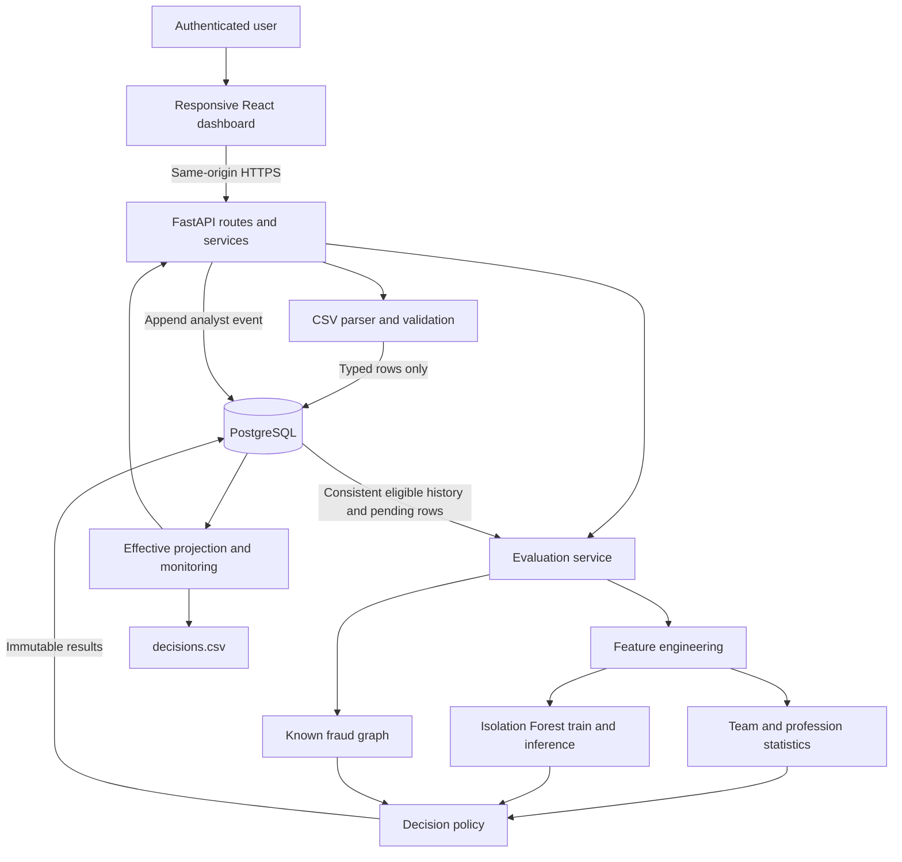
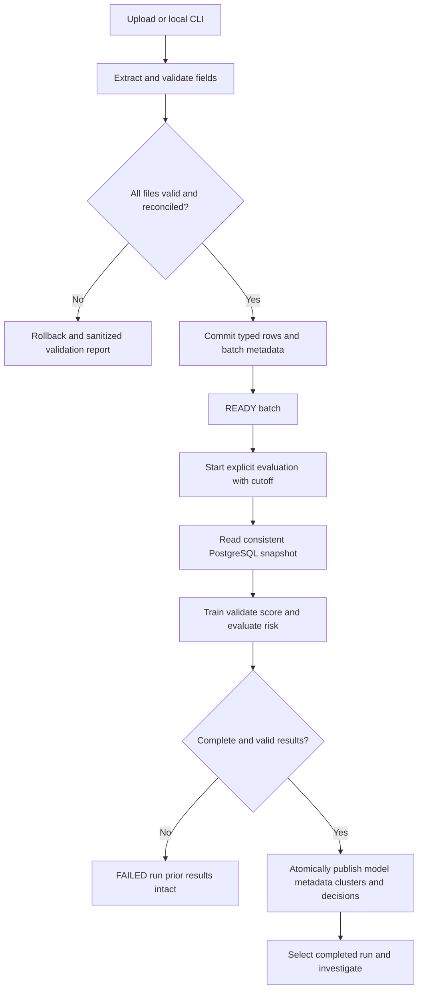
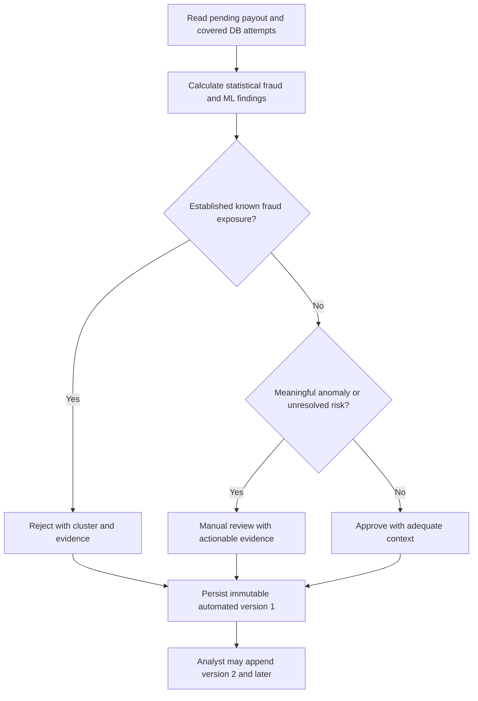

# Payout Risk Desk system design

## High-level design

### Scope and deployment

I'm building a reusable risk operations application for the ScanPay assessment. Initial assessment mode evaluates the 20 supplied pending payouts as of 13 November 2026 10:00 IST. New batches can be imported and evaluated without reloading all prior history. The original brief does not mandate ML, login or uploads; these are selected project enhancements. Deployment is required by the updated submission instructions. No actual payment execution.

| Component | Responsibility |
| --- | --- |
| React + TypeScript | Login, upload, batch/run selection, dashboard, payout queue, evidence, analyst override timeline |
| FastAPI | Same-origin APIs, authentication/authorization, import, evaluation orchestration and exports |
| PostgreSQL | All five CSV schemas mapped to typed source columns; run, model metadata, predictions and append-only override events |
| Risk engine | Query DB snapshot, compute comparable features, statistical baselines, fraud graph, Isolation Forest and final policy |
| Render + Neon | Single Render container serves built UI/API; separate synthetic Neon database |

Private local application accepts actual files and processes them entirely on the developer's machine, outside AI agent access. CSVs are transient; no raw file objects in PostgreSQL, no external inference. The hosted demo uses fabricated data only; arbitrary uploads disabled at the backend. Provide an admin-controlled built-in synthetic batch import to demonstrate the workflow; reviewer accounts can inspect and override in their own scope. No real-data upload to Render/Neon unless explicitly authorized. One Render service with React build served by FastAPI, TLS Neon pooled app connection and direct migration connection. Environment secrets not committed. Use `PORT`, relative API paths and Vite proxy. Separate synthetic/actual credentials, no cross-environment connections; no fitting at app startup or dashboard read. Health checks DB and usable app configuration; dataset readiness separately exposed. Use migrations, Docker and CI on synthetic fixtures.

### Payout rules

Use Asia/Kolkata; source times without offset mean IST. Match covered attempts by team and inclusive collection dates. Payouts created weekdays at 17:30 IST: Mon→Wed, Tue→Thu, Wed→Fri, Thu→Mon, Fri→Tue; weekend joins Monday for Wednesday. Captured amount plus tip and count only; retain all declined/refunded attempts for analysis. Initial 24 teams, Oct 21–Nov 9 collections; Oct 23–Nov 11 historical payouts; pending Nov 12 covering Nov 10. Future runs take explicit cutoff and batch. Validate initial expected counts, not universal limits. No payout scheduler.

## Low-level design

### Data ingestion and evaluation

Initial upload five typed files, incremental upload latest transactions and pending payouts with optional teams and historical dispositions. Stream/bound input size, validate schema/keys/references/money/cutoff and reconcile against staged plus stored data. Persist normalized columns only, and non-content metadata (checksum, row counts, source IDs). Identical reimports are no-op, conflicts rejected except documented once-only pending-to-history disposition. Remove any temporary file. Keep import READY distinct from evaluation QUEUED/RUNNING/COMPLETED/FAILED. Only complete runs are visible as results. For the assessment, synchronous bounded processing is acceptable; if using background execution, persist run status, prevent duplicate execution, handle restart/failure and never claim completion before publish. CPU work off async event loop; no Kafka/Redis needed.

### ML and statistical design

Use currently accepted DB records within a frozen as-of snapshot, not raw CSVs and not a naive status=active filter. Read approved historical dispositions known by cutoff, compare full windows/team-days, exclude current/pending, future, confirmed fraud and contaminated slices. Suspended team status is context, not blanket exclusion of all legitimate past activity or fraud evidence. Use team and leave-team-out profession baselines, minimum sample and material effect gates, safe zero spread and sparse fallback. Build comparable historical vectors with earlier information only. Train one pooled Isolation Forest, chronological validation, fit preprocessing only on training, explicit quality gate and actionable evidence. Score selected pending payouts from DB. Version model by eligible history fingerprint and config, retrain when history changes; reuse only exact compatible trusted model or deterministically refit. Persist score, threshold, status, feature evidence and model version. ML is mandatory implementation and attempted on every normal run; never silently default off. No promise of accuracy; gate weak models and fall back to stats/fraud, review material uncertainty. Never train on unverified overrides, never use score as fraud probability, never reject on ML alone. See risk-engine-design.md.

### Known fraud and final decision

Build supported graph from historical REJECTED fraud codes and actual case evidence available at cutoff, including historical notes locally. Separate supported strong links from suspicious weak leads, no blank identifier links or victim propagation. Deterministic known case keys and run-specific cluster snapshots; no hardcoded decisions. Fraud takes precedence, then meaningful statistical/actionable validated ML anomaly or unresolved risk, else approval. Reasons and supporting source IDs for every review/reject, known cluster for Reject. Preserve all automated findings even when a different signal determines the decision.

### APIs, identity and audit

See api-design.md for full contracts. Use `/api` same-origin routes. Authenticated roles Admin (import/evaluate), Analyst (inspect/override/export), Viewer (read only). Use signed short-lived HttpOnly cookie, server-side role lookup and auth version, Origin/CSRF protection, secure production cookie, rate-limit login and costly writes, password hashing Argon2id. No self-registration. Public demo uses authorized synthetic reviewer accounts; account-scoped overrides; local shared scope identifies real authenticated actor. Original decision and all events immutable. Derive effective status from latest version; retain source AUTOMATED/HUMAN and CURRENT/SUPERSEDED. Override requires reason, expected version, evidence for flagged state, established cluster for Reject. Record actor from auth context. A 409 prompts refresh; update queue/dashboard/export after successful append. Re-evaluation creates separate run, does not erase prior events. Export selected completed run, not filtered table.

### Monitoring and export

Count AND USD for automated approval, analyst approval, waiting review and rejection, plus total. Group historical payout creations in IST over 20 calendar days immediately before selected batch's payout creation date (for initial batch Oct 23–Nov 11). Only outcomes known by run cutoff and available in the frozen run snapshot; persist historical aggregates in the run summary so subsequent imports cannot change the old chart. Historical manual approval is resolved, not open review. Label historical per-day denominators, date range and scope; don't mix payout creation with collection date. Export `payout_id,team_id,decision,fraud_cluster,reasons,evidence`, one row per selected pending payout, deterministic payout-ID order, exact `Approve`, `Manual review`, `Reject`. Cluster blank except Reject; one or two actionable sentences, source IDs only. Initial assessment exactly 20 rows. Current effective state from one snapshot; actual export private.

### Responsive frontend and design system

Use React, TypeScript, Vite, Tailwind, shadcn/ui or equivalent accessible primitives, Lucide, Recharts and TanStack Query. Central CSS tokens for navy/slate/blue theme, surfaces, borders, typography, spacing, focus and semantic status. Proposed theme, not verified official ScanPay brand. Consistent components, readable currency/date formats and accessible contrast. No gradients/oversized decoration or hardcoded KPIs. Pages: login; overview with batch/run selector; datasets with initial/incremental upload and validation; evaluations with status/model metrics; payout queue with filters; detail with original/effective, attempts, evidence, team/profession comparisons, model status and history; fraud/model insights as useful panels; CSV export. Audit shows actor, version, previous/new decision, timestamp and reason. Admin upload/evaluation controls only; demo explicitly shows synthetic preset mode. Loading/empty/error/conflict states; accessible upload controls and dialogs. Test 360/768/1024/1440 CSS px, flexible grid/flex, collapsed mobile navigation, stacked cards, contained table scroll or mobile cards, responsive charts and keyboard/touch support. No page-level overflow.

### Verification

Verify relational imports (every source field, no files stored), initial and incremental dedup/conflict rollback, pending disposition promotion, DB-only evaluation after input removal, leakage-free features, model validation and fallback, known fraud evidence, full-batch persistence, append-only overrides and actor identity, run isolation, counts and cents, export schema, demo upload restriction and responsive UI. Actual dataset validation and ML metrics remain unverified until private execution. See testing-strategy.md.
