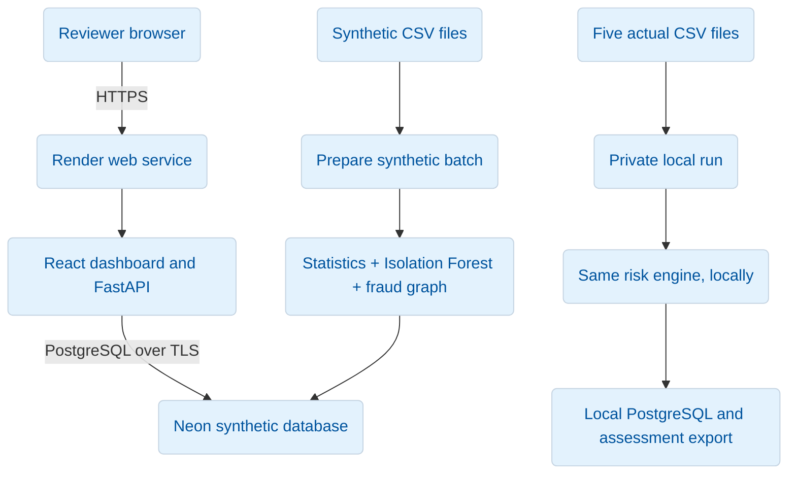
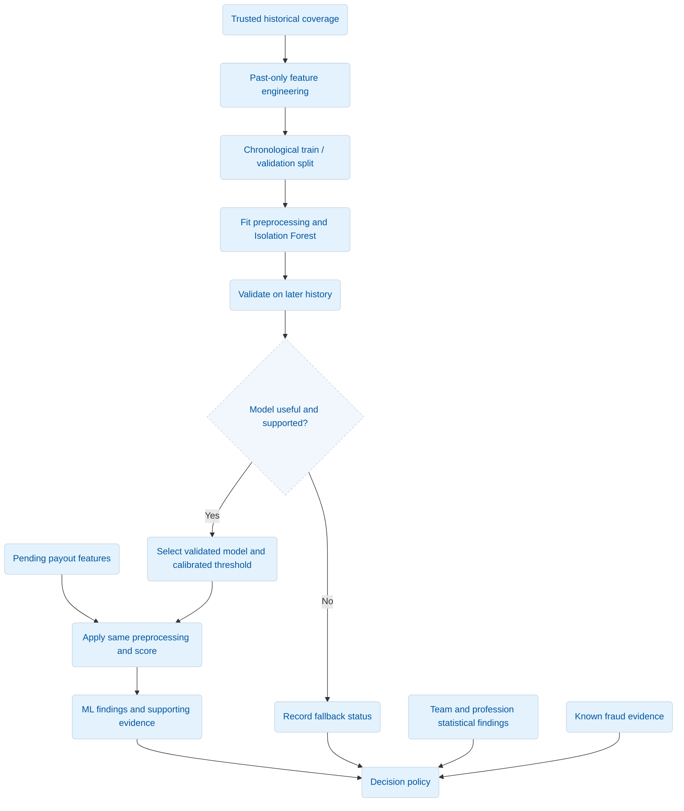
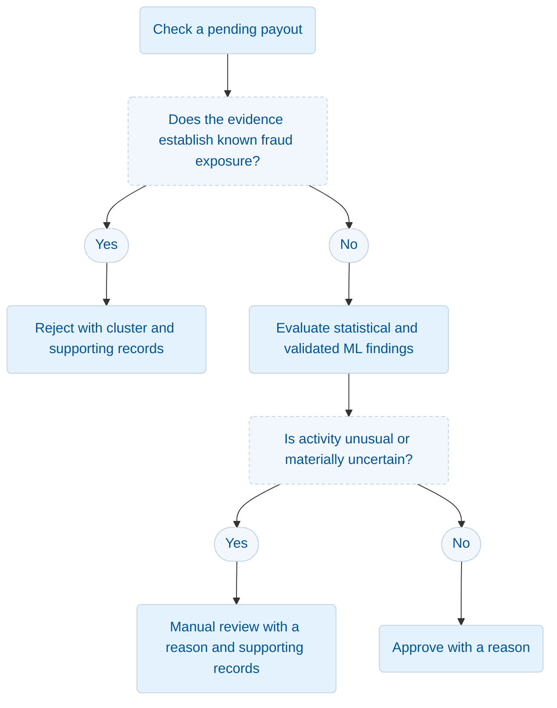

# Payout Risk Desk system design

## High-level design

### Scope and deployment

I'm building a dashboard for the pending payouts in the ScanPay brief. The analyst can see every decision and its evidence, change a decision with a reason, compare counts and dollars with the preceding 20 days, and export `decisions.csv`.

| Component | Responsibility |
| --- | --- |
| React, TypeScript, Vite, Tailwind CSS and shadcn/ui | Show the monitoring summary, payout queue, evidence, baseline comparisons, model findings, and override history in a responsive dashboard. |
| FastAPI | Serve the UI and same-origin API for investigation, overrides, monitoring, and export. |
| Local processing command | Read the five CSVs, reconcile payout totals, learn historical baselines, train and validate Isolation Forest, build the known-fraud graph, evaluate and publish the complete batch. |
| Risk engine | Pandas/NumPy for features and statistics, NetworkX for evidence-backed fraud clusters, scikit-learn for Isolation Forest, and deterministic decision policy. |
| PostgreSQL | Store source records, known cases, original decisions, and override events. See the [database design](database-design.md). |
| Render and Neon | Render runs the application. A separate Neon database holds the synthetic reviewer data and overrides. |

I'll run the actual assessment data and generate the real export on my machine with local PostgreSQL. I'll share only column names, data types, and my code with AI tools. The hosted application uses independently fabricated inputs. The public reviewer link demonstrates the same decision and review workflows.

Render serves the built UI and FastAPI from one container on the supplied `PORT`. I'll use a Neon pooled TLS connection for app requests and a direct connection for migration and seeding. Connection strings and the cookie signing key stay in Render environment variables. I'll configure `/health` to check the database and synthetic batch before sharing the link. [Render web services](https://render.com/docs/web-services) · [Neon connection pooling](https://neon.com/docs/connect/connection-pooling)

The six-table PostgreSQL design is shared across environments. The private and synthetic deployments have separate databases, credentials and model artifacts. The web process reads published decisions; it does not retrain or ingest datasets on HTTP requests.

The original brief excludes logins, user roles and permissions. The current design uses anonymous, server-signed review scopes rather than JWT/RBAC, consistent with the revised architecture. A scope isolates demonstration writes; it is not an authenticated identity. Do not expose private records through this deployment.

### Payout rules

The decision cutoff is **13 November 2026 at 10:00 AM IST**. The pending payouts were created on **12 November at 5:30 PM IST** and cover **10 November** collections. The source filenames and headers match the brief. The exact mappings are in the [database design](database-design.md#source-files).

I use the IST date of each payment and match it by team ID and the payout's inclusive coverage dates. Payouts run on weekdays at 5:30 PM IST, two business days after collection. Monday through Wednesday pay Wednesday through Friday, Thursday pays Monday, and Friday pays Tuesday. Weekend payments join Monday's collections for Wednesday. The payout total is `amount_usd + tip_usd` for captured payments only. Declined and refunded attempts stay available for risk analysis. I'll check the captured count and amount before publishing all decisions together.

## Low-level design

### API endpoints

I'll use one dashboard with a summary, a payout queue, and a detail view. The browser can filter and sort the payouts. Export always uses the full batch.

| Endpoint | What I'll use it for | Request and response |
| --- | --- | --- |
| GET `/api/dashboard` | Compare current exposure with history. | Returns batch creation time and covered dates, total payout count and cents, counts and cents for automatic approvals, analyst approvals, open review, and rejects, plus daily historical totals and a sanitized model status and validation summary. |
| GET `/api/payouts` | Show every pending payout and its effective decision. | Returns payout ID, team ID and name, profession, amount in cents, captured count, effective decision, short reason, cluster ID for Reject, override marker, and current version. |
| GET `/api/payouts/{id}` | Explain why the payout received its decision. | Returns original and effective decisions with their reasons, evidence, and clusters, plus the effective version, covered attempts, team and profession comparisons with sample counts, model status and score when available, the case evidence path, and the scoped override timeline. |
| POST `/api/payouts/{id}/overrides` | Change a payout decision and keep a record of the change. | Accepts `decision`, `reason`, `expected_version`, supporting `evidence`, and `fraud_cluster` for Reject. Returns HTTP 201 with the recorded change and new effective state. |
| GET `/api/exports/decisions.csv` | Download the entire decision batch. | Returns `decisions.csv` as `text/csv`, using effective decisions for the current review scope. |
| GET `/health` | Check hosted readiness. | Returns HTTP 200 when PostgreSQL is reachable and the published batch is available. Returns HTTP 503 otherwise, with a sanitized response. |

I'll group historical payouts by IST creation date from **23 October through 11 November 2026**, using dispositions available by the decision cutoff. I'll show separate counts and dollars for `AUTO_APPROVED`, `MANUAL_APPROVED`, and `REJECTED`, and mark calendar days without payouts explicitly. A historical manual approval represents a completed review, so it does not measure an open review queue. If I show an average beside the current batch, I'll label it as per historical payout day and state the number of days used.

### How I'll learn normal behaviour

The submitted decisions will use **team and profession medians and interquartile ranges (IQR)** together with validated ML anomaly findings. This gives me the actual value, the historical range, and the records behind each unusual result.

- I'll start with payout amount, captured payment count, typical captured payment amount, and the decline rate across covered attempts.
- I'll use comparable approved historical coverage with decisions known by the cutoff and exclude fraud-implicated activity. For multi-day coverage, I'll compare comparable windows or calculate daily features separately. For profession comparisons, I'll exclude the current team from its peer group.
- I'll require sufficient observations and a material difference beyond the historical spread. If spread is zero, I'll apply the feature's minimum absolute difference. I'll record observed and baseline values, sample counts, threshold, and supporting IDs.
- If team history is sparse, I'll use a credible profession baseline. If the available data leaves material uncertainty, I'll send it for review and explain what the analyst should check.

### Machine learning design

**Isolation Forest is a required implementation component** of this project, not a disabled experiment. The brief requires learning from history, not a specific algorithm; this is my chosen ML enhancement. I will implement training, chronological validation, inference, diagnostic reporting and integration into the review policy. Inference runs as part of each private or synthetic batch when the model is fit and usable. There is no default switch that silently bypasses ML. If the data cannot support a reliable model, publish a clear fallback status and reason; statistics and known fraud evidence remain available. I will not claim validation success before measuring it.

| Stage | Design |
| --- | --- |
| Observation unit | Comparable approved historical payout windows or team-days; use the same unit at training and inference. |
| Features | Captured amount/count, typical and maximum payment size, decline rate, tip ratio, unique card count and comparable relative team/profession deviations. Avoid IDs, PII and decision labels as features. |
| Trusted history | Use only earlier approved coverage with decisions available at the relevant time; exclude known fraud and contaminated feature slices. Retain verified legitimate outliers as evaluation context. |
| Validation | Chronological training/validation split; baselines for each training/validation observation come from earlier available data. Fit imputation and preprocessing on training only. No pending-day data or future decisions enter training or threshold selection. |
| Model | One pooled Isolation Forest across normalized comparable observations, not one tiny model per team. Start with `n_estimators=100`, `max_samples=auto`, `contamination=auto`, `random_state=42`; settings are versioned, not tuned claims. |
| Quality gate | Require sufficient eligible training/validation observations and feature coverage; assess review workload, apparent false alerts, detection of verified outliers, and whether new findings have actionable evidence. Define configurable gates before validation; do not assume perfect labels. |
| Inference | Score every eligible pending payout using the same fitted preprocessing and model. Store `-score_samples` (higher is more unusual), threshold and anomaly flag. It is not a fraud probability. |
| Decision use | A validated, material and evidence-backed ML-only finding may trigger Manual review. A diagnostic-only score without a defensible finding cannot change the decision. Only known fraud evidence can cause Reject. |
| Fallback | If fit, validation, feature coverage or inference fails, record `INSUFFICIENT_HISTORY`, `VALIDATION_FAILED` or `INFERENCE_FAILED` as appropriate, with a sanitized reason. Use statistics/fraud rules; review material uncertainty. Never substitute invented scores. |
| Reproducibility | Version feature schema, model configuration, training window, validation policy and code. Retain model metadata and per-payout findings in JSONB. Keep fitted artifacts outside Git; private fitted artifacts never leave local storage. |

Use deterministic statistical/evidence templates to describe the observed combination of unusual features. Do not imply that a simple deviation is a formal Isolation Forest feature attribution. If evidence cannot explain the finding, the ML score stays diagnostic. After chronological validation, refit the selected configuration on eligible pre-action history only if the threshold calibration remains compatible; otherwise retain the validated fitted model. Record the final fit window and threshold policy. Do not tune on pending payouts. See [risk-engine-design.md](risk-engine-design.md) for the implementation contract.

[scikit-learn Isolation Forest](https://scikit-learn.org/stable/modules/generated/sklearn.ensemble.IsolationForest.html)

### How I'll recognize known fraud

I'll read historical `REJECTED` cases marked `FRAUD_CARD_RING`, `FRAUD_CARD_TESTING`, or `FRAUD_ACCOUNT_TAKEOVER` and inspect the historical reasons locally. Build a typed NetworkX graph using supported links between historical case seeds and implicated entities. Connected components of corroborated case links define clusters, with a deterministic canonical historical seed and stable cluster ID. Keep all case seeds and evidence paths in typed JSONB supporting records; do not merge unrelated cases merely because of a shared weak identifier or fraud category. Each supported case gets a stable cluster ID and references to the records actually implicated. If multiple cases qualify for one payout, I'll select the strongest supported link and break ties by cluster ID.

A captured payment on a specifically implicated card can establish exposure when the historical and current records support it. Shared phone, device, or routing and last four are leads that require corroboration. Blank ACH fingerprints contribute no link. `CARD_TESTING_VICTIM`, `OUTLIER_VERIFIED`, and `VOLUME_SPIKE_VERIFIED` are review context. I'll show the current record, the historical record, and what connects them.

### Responsive frontend and design system

Use shadcn/ui (Radix primitives with Tailwind) or an equivalent accessible component library. The dashboard should look like a coherent financial operations product, not a collection of unrelated templates. Use a restrained navy/slate/blue theme inspired by the existing diagrams, neutral backgrounds, consistent border radius, typography, spacing and semantic status tokens (green approval, amber review, red rejection, neutral unavailable). These are project design choices, not a claim about ScanPay's official branding. Centralize tokens in CSS variables; use them across buttons, cards, tables, badges, forms, charts, dialogs, tooltips and focus states. Avoid hardcoded colours per page, oversized cards, excessive gradients and decorative animation. Support light mode as the primary theme; if dark mode is added, verify every component and chart uses the same tokens.

| Screen / component | Behaviour |
| --- | --- |
| Dashboard | Batch context and demo notice, total exposure and four clearly labelled counts/dollars (automatic approvals, analyst approvals, review, rejects), history trend charts, decision breakdown and priority queue. |
| Payout queue | Search by payout/team, filter decision and profession, sort by amount and other columns, reset filters, accessible status labels, full-batch export. |
| Detail view | Original/effective decisions, captured and noncaptured attempts, structured risk findings, team and profession comparison, ML status/score and explanation, known case evidence, override history. |
| Override dialog | Select valid decision, required reason, supported evidence and cluster when rejecting, version check, confirm action, error feedback and refresh. |
| Historical/fraud sections | Expandable historical case evidence and baseline charts, sample counts and date ranges, clear distinction between confirmed cases and weak leads. |
| Loading/error/empty | Skeletons, retry, meaningful empty states, accessible validation messages; never show invented data. |

Desktop: compact navigation and wide table/detail layout. Tablet: collapse navigation and reflow cards/charts. Mobile: stack summary cards, use a drawer/sheet or full-screen detail, make filters usable in a popover/sheet and keep a table's horizontal scrolling contained or use equivalent compact cards. Do not let the page itself overflow horizontally. Verify at 360, 768, 1024 and 1440 CSS px and with keyboard navigation, zoom, readable contrast and focus. Labels and icons must accompany colours. Use responsive chart containers and suitable axis/legend layouts. Keep actions visible, use consistent currency/date formatting, and ensure all reviewer workflows remain usable on small screens. Prefer TanStack Query for typed API server state and invalidation after override. Avoid separate pages and endpoints unless genuinely needed; existing six endpoints can serve the entire dashboard.

### Overrides and export

I'll preserve the original outcome and append a new override when an analyst changes it. The reason is mandatory. Manual review requires supporting records and Reject requires an established link to the chosen cluster. If the analyst overrides a Reject to another outcome, the current cluster clears and the prior cluster remains in the audit history. An unknown payout returns HTTP 404. A stale version returns HTTP 409. An invalid reason, decision, or evidence reference returns HTTP 422. On success I'll refresh the queue, detail, and monitoring. The [override transaction](database-design.md#effective-decisions-and-overrides) defines the write order.

The local app uses one review scope. For the hosted demo I'll establish a random reviewer scope on the initial page response, before the dashboard sends API requests. I'll store it in an expiring server-signed cookie with HttpOnly, SameSite, and Secure over HTTPS. I'll resolve and validate the scope on the server, check the Origin on state-changing requests, and mark scoped responses private and non-cacheable.

The CSV header is `payout_id,team_id,decision,fraud_cluster,reasons,evidence`. Each pending payout appears once in source payout-ID order. The values are exactly `Approve`, `Manual review`, and `Reject`. Only Reject has a cluster. Each row has one or two plain-English sentences and the supporting transaction, payout, or team IDs.

### What I'll verify before hand-in

- I'll verify capture-only reconciliation, exact payout IDs, normal and unusual team or profession activity, confirmed fraud, weak links, and blank ACH fingerprints.
- I'll verify the model trains, scores eligible payouts and records the validation result, test ML-only review with actionable evidence, and verify fallback and the prohibition on ML-only rejection.
- I'll check the responsive dashboard on desktop, tablet and mobile, including keyboard operation, filters, charts and override dialogs.
- I'll change a decision with a reason, inspect the audit event, verify the counts and dollars after the change, and confirm a separate demo session keeps its own view.
- I'll run the real files privately, verify the export and evidence, and prepare a walkthrough of the dashboard, a decision, an override, and the CSV. I'll share the Render and GitHub links and deliver the actual export privately.